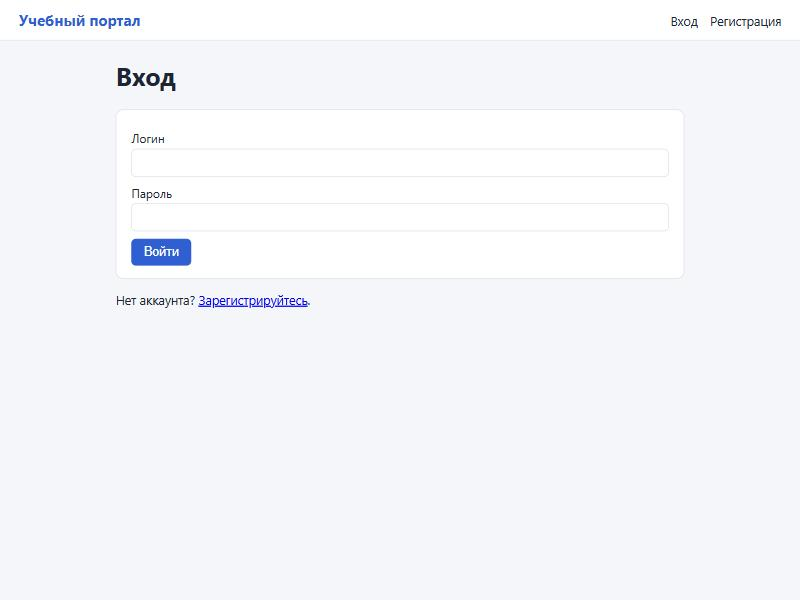
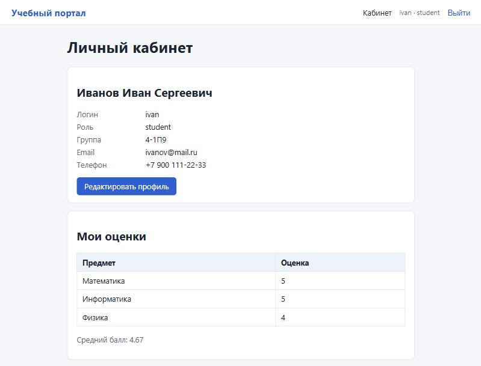
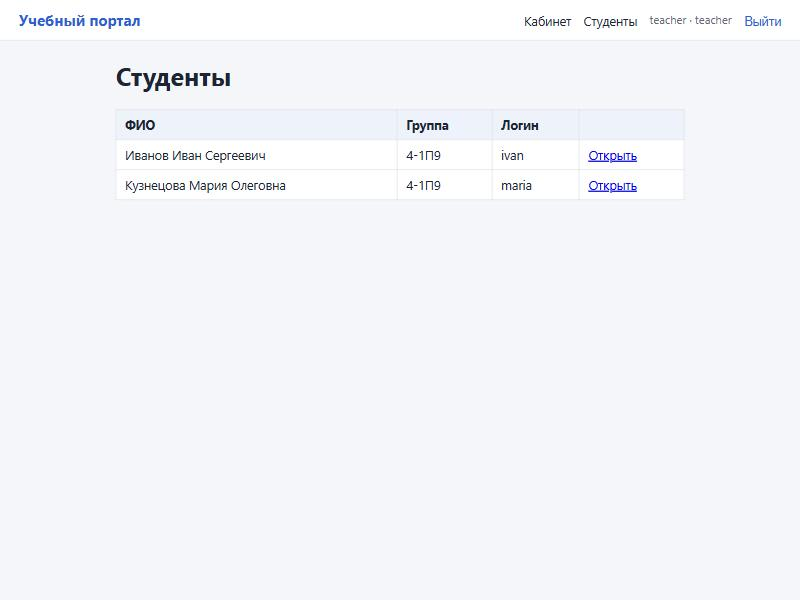
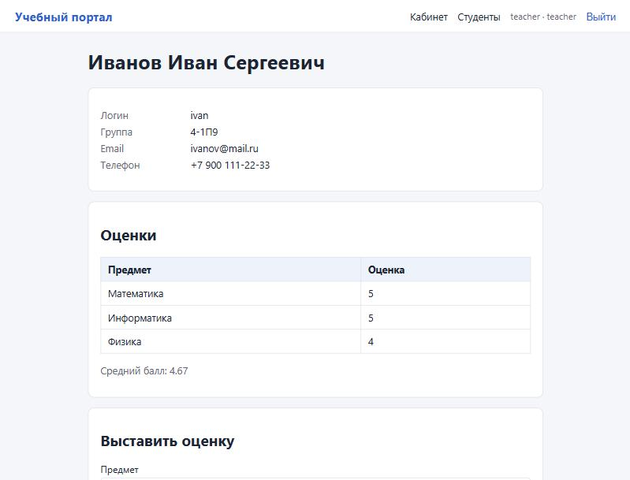

# Личный кабинет студента


Учебная практика УП 02.02, тема 2: **модуль личного кабинета студента с ролями и разграничением доступа**.
В репозитории лежит сам модуль `student_cabinet` и сайт на Flask и Jinja2, на котором он показан.

## Возможности

- регистрация и вход (пароль хранится как хэш, доступ по подписанному токену);
- три роли: студент, преподаватель, администратор, права задаются таблицей `ROLE_PERMISSIONS`;
- студент видит и правит свой профиль, смотрит свои оценки;
- преподаватель видит студентов и выставляет оценки;
- администратор меняет роли пользователей.

## Архитектура

```
Браузер  ->  Flask (src/app.py, шаблоны Jinja2)  ->  CabinetService (src/student_cabinet)  ->  SQLite
```

```
.
├── .github/            # CI, шаблоны PR и Issue, CODEOWNERS
├── src/
│   ├── app.py          # маршруты Flask
│   ├── seed.py         # демо-пользователи
│   ├── student_cabinet/  # модуль (бизнес-логика, роли, безопасность)
│   ├── templates/      # Jinja2
│   └── static/
├── tests/              # тесты модуля и сайта
├── docs/               # ER, UML, требования, QA, ретроспектива
├── CHANGELOG.md
└── requirements.txt
```

Схема данных и диаграммы: [ER](docs/er_diagram.drawio), [Use Case](docs/usecase_diagram.png),
[Sequence](docs/sequence_diagram.png), [нефункциональные требования](docs/nonfunctional_requirements.md).

## Как подключён модуль

Папка `student_cabinet/` скопирована в `src/` рядом с `app.py`. В `app.py` создаётся один сервис,
и маршруты вызывают его методы. Проверку прав делает сам модуль, в маршрутах нет ни одного `if role == ...`:

```python
from student_cabinet import CabinetService, Role

cabinet = CabinetService(db_path="portal.db", secret_key=secret)
session["token"] = cabinet.login(username, password)       # вход
g.user = cabinet.authenticate(session["token"])             # кто вошёл
cabinet.get_profile(g.user, g.user["id"])                   # профиль
cabinet.add_grade(g.user, student_id, "Математика", 5)      # только teacher и admin
cabinet.set_role(g.user, user_id, "teacher")                # только admin
```

Исключения модуля (`AccessDenied`, `NotFound`, `AuthError`) превращаются в страницы 403, 404 и редирект на вход.

## Запуск

```bash
pip install -r requirements.txt
python src/seed.py      # демо-пользователи, один раз
python src/app.py       # http://127.0.0.1:5000
```

| Роль          | Логин     | Пароль         |
|---------------|-----------|----------------|
| Администратор | `admin`   | `admin12345`   |
| Преподаватель | `teacher` | `teacher12345` |
| Студент       | `ivan`    | `student12345` |

Это тестовые данные для демонстрации.

## Тесты и проверка стиля

```bash
pytest --cov=src          # 33 теста, покрытие 82 %
flake8 src tests
black --check src tests
isort --check-only src tests
```

Перед коммитом: `pre-commit install`, после этого проверки запускаются автоматически.

## Скриншоты

| Вход | Кабинет студента |
|------|------------------|
|  |  |

| Студенты | Выставление оценки |
|----------|--------------------|
|  |  |

## Процесс

Ветка на задачу `feature/<номер issue>-короткое-имя`, PR по шаблону, ревью у второго участника,
слияние в `main` только после зелёного CI. Версии и изменения: [CHANGELOG](CHANGELOG.md).

## Результаты автоматического тестирования

Автоматическое тестирование проекта выполняется с использованием pytest и GitHub Actions.

Результаты последнего успешного запуска:
- Всего тестов: 33.
- Успешно пройдено: 33.
- Ошибок: 0.
- Общее покрытие кода тестами: 82%.

## Запуск автоматических тестов

Для проверки работоспособности проекта используются Python, pytest и pytest-cov.

### Установка зависимостей

Перейдите в папку `repo` и выполните команду:

```bash
python -m pip install -r requirements.txt
```

### Запуск тестов

Для запуска автоматических тестов выполните:

```bash
python -m pytest
```

### Получение отчёта о покрытии

Для получения подробного отчёта о покрытии кода выполните:

```bash
python -m pytest --cov=src --cov-report=term-missing
```

Результаты проверки отображаются в терминале. Отчёт показывает количество пройденных тестов, процент покрытия кода и строки, которые не были проверены.

## Основные маршруты приложения

| Маршрут | Назначение |
|---|---|
| `/` | Главная страница |
| `/register` | Регистрация пользователя |
| `/login` | Авторизация |
| `/logout` | Выход из системы |
| `/cabinet` | Личный кабинет |
| `/profile/edit` | Редактирование профиля |
| `/students` | Список студентов |
| `/students/<student_id>` | Просмотр информации о студенте |
| `/students/<student_id>/grades` | Работа с оценками |
| `/admin/users` | Управление пользователями |
| `/admin/users/<user_id>/role` | Изменение роли пользователя |

Доступ к маршрутам ограничивается в зависимости от роли пользователя.


## Релизы

Текущая версия проекта: **v0.1.0**.

[Посмотреть релиз v0.1.0](https://github.com/Kirill-44/student-cabinet/releases/tag/v0.1.0)
